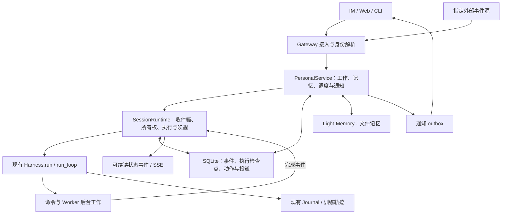

# Personal Agent：长期常驻架构与分阶段实现方案

> 状态：设计提案，尚未实现。本文中的新模块、接口、配置和测试名均为拟议方案。
>
> 调研与源码基线：2026-11-05；本地提交 `915520584c92cc35ed24aef1af17eec1d60c0b01`。
> 实施前应重新核对主分支差异。本文不把公开产品行为当成厂商内部实现，也不表示已经完成真实设备、重启恢复或多副本验收。

## 1. 目标与架构决策

目标是让用户把一项工作或持续责任交给 HarnessX 后，系统能够在对话之外继续推进，在需要决策或有可交付结果时联系用户；后台工作期间，用户仍能交互、改向和停止。

第一版面向一个拥有者的个人助理，可接入多个本人身份和多个渠道；后台 job 先支持验收过的本地后端，多个远程执行环境后续扩展。单进程服务部署在持续在线的主机上；同一运行目录只允许一个服务写入。群聊、项目和 Worker 上下文保持独立，按权限共享相关信息。

核心决策：

1. **保留唯一的 ReAct 实现。** 改造现有 `run_loop()` 的输入边界、异步工作与等待行为；不新增另一套复制模型调用、Processor 和工具执行逻辑的 `super_loop()`。
2. **增加常驻运行层。** `SessionRuntime` 负责收件箱、执行所有权、取消和唤醒；运行在现有 `asyncio` 上。它管理什么时候运行，不代替 `run_loop()` 决定如何推理。
3. **个人主 Agent 可以直接做短任务。** 复杂或耗时工作按需交给后台命令或 Worker；不强制每个请求都经过独立 Router 和工单派发。
4. **个人身份、对话、持续工作、执行尝试分别保存。** 同一个人能跨渠道连续协作，但不把所有历史放进同一个上下文窗口。
5. **持久运行状态由 SQLite 管理，记忆优先复用 Light-Memory。** Journal 继续承担轨迹、调试与训练输出；交互模式不能依赖 JSONL 与 SQLite 双写恰好同时成功。
6. **承认外部副作用的不确定性。** 内部采用持久接收、去重与可恢复执行；对外不承诺通用 exactly-once，不自动重放结果未知的发送、发布或修改动作。
7. **常驻的是服务、状态和调度。** 没有待处理输入时不持续调用模型；恢复依靠持久记录，不依靠一个永不退出的协程。
8. **个人助手也采用声明式组合。** 个人模式提供通用宿主与可选预设；主 Agent、Worker 的模型/行为、提示词、工具、记忆和执行策略由配置选择，不把某个固定人格、模型或工具清单写死在服务里。

首版不做分布式多主调度、通用 A2A 协议、复杂 Agent Team、全平台主动接入或自修改代码的 Watchdog。远程设备访问通过现有执行环境抽象逐步扩展，离线设备上的工作不能伪装成仍可执行。

## 2. 调研取舍

| 参考 | 已公开、可借鉴的内容 | 在 HarnessX 中的取舍 |
| --- | --- | --- |
| OpenAI Dot | 持续责任、暂停与唤醒、并行委派、跨渠道身份与笔记连续、任务可见性 | 作为个人助理产品目标；不假定其底层 loop、数据库或 Worker 拓扑已公开 |
| Claude Duet | 持续主对话、设备离线后仍运行的云端环境、间隔检查、任务页面、主动通知 | 关注事项检查与通知选择；不要求持续高频模型轮询 |
| Meta Muse | 主聊天与旁聊、目标和活动视图、用户可编辑记忆、独立 Sentinel、执行单元与凭据/持久状态分离 | 补充产品可见性与动作执行边界；不把 Sentinel 当作进度 Watchdog，也不照搬其整套 VM/eBPF 基础设施 |
| OpenClaw | 常驻 Gateway、个人主会话、队列与 steering、自动化和消息投递 | 参考入口、会话和调度的工程组织，不直接移植 TypeScript 代码 |
| Letta | 持久身份与记忆、跨会话检索、后台记忆整理 | 优先完善现有 Light-Memory 生命周期；保留替换后端的边界 |
| DeepSeek Super-agent | Router/Worker、Thread 订阅直通、工作与执行生命周期 | 多任务与跨平台跟进增长后采用；首版不照搬完整领域模型 |
| Anthropic Managed Agents | Session 日志、Harness 与执行环境解耦 | 保存可恢复状态，允许执行逻辑和执行环境独立失败、替换 |

Dot/Duet 属于产品行为参考；Muse 还公开了部分宿主、隔离和授权执行设计，仍不等于其完整调度源码已公开。OpenClaw/Letta/DeepSeek 可进一步查源码。Managed Agents 的接口设计可独立借鉴；Duet 引用了其部分隔离设计，不能据此认定两者完整内部架构相同。资料与核验范围见第 14 节。

这些资料支持的是“持久宿主 + 单会话串行推理 + 可并发的后台工作 + 事件接收/唤醒 + 工作与记忆连续性”，不要求一套新的推理算法。本文的 Personal Agent 是整个系统；Router 是来源解析、确定性关联和必要语义判断组成的逻辑层，首版由程序与主 Agent 分担，不再强制增加一个 Router Agent。DeepSeek 的 Source/Trigger 对应来源/输入事件，Thread 对应来源会话，Ticket/Assignment 对应工作/执行尝试；已知 job 的返回关联先用普通记录实现，只有确有多对多需求才引入完整 Subscription 模型。

## 3. 现有模块与实际缺口

以下结论来自本地 owning source；设计文档中的能力描述不代替代码核对。

| 当前模块 | 当前行为 | 需要修改的边界 |
| --- | --- | --- |
| [`core/harness.py`](../../harnessx/core/harness.py) | `Harness.run()` 创建/恢复状态、调用 loop、回填奖励并返回结果；恢复时按新任务追加预算 | 为交互执行增加可选运行上下文；同一次执行唤醒不能追加预算；恢复仍须由执行游标决定下一动作 |
| [`core/runloop.py`](../../harnessx/core/runloop.py) | 顺序等待模型、逐个等待工具；无工具的 `stop/end_turn` 可退出 | 步骤边界消费事件、工具前检查改向、等待后台结果、恢复未完成步骤 |
| [`core/events.py`](../../harnessx/core/events.py)、[`state.py`](../../harnessx/core/state.py) | Processor 生命周期事件、消息双轨、预算、pending subagents、可序列化快照 | 保持训练事件语义；运行层事件单独定义；快照增加版本与消费游标关联 |
| [`tools/spawn_subagent.py`](../../harnessx/tools/spawn_subagent.py) | `wait=False` 创建模块级后台 task，完成后直接写父状态 | 托管到执行所有者；完成只投递事件；可取消、可查状态、不复用父可变 Processor/tracer |
| [`tools/builtin/bash.py`](../../harnessx/tools/builtin/bash.py) | 等待完整命令输出或超时 | 显式后台启动、输出文件、任务级停止；保留同步调用兼容 |
| [`tools/base.py`](../../harnessx/tools/base.py)、[`tools/_dict_registry_mixin.py`](../../harnessx/tools/_dict_registry_mixin.py)、[`core/config_schema.py`](../../harnessx/core/config_schema.py) | 工具描述、schema、同步/协程函数执行与声明式配置；尚无通用前后台模式策略 | 增加可序列化执行策略和工具能力声明；配置可默认后台，但只作用于具备已验收后台能力的工具 |
| [`core/builder.py`](../../harnessx/core/builder.py)、[`core/config_store.py`](../../harnessx/core/config_store.py)、[`api/models.py`](../../harnessx/api/models.py)、[`api/routes/run.py`](../../harnessx/api/routes/run.py) | Builder 有 slot 白名单；API payload 与配置装配另有字段集合 | 新行为字段贯通 YAML、Builder、结构化注册与受影响的 API/Console 保存路径；不能只加 dataclass 后在装配中丢失 |
| [`sandbox/base.py`](../../harnessx/sandbox/base.py) 及各后端 | `exec()` 与整体 `kill_running()`；未定义统一 job 级生命周期 | 增加可选 job 能力，先实现本地；不支持的后端明确返回能力不足 |
| [`gateway/core/dispatch.py`](../../gateway/core/dispatch.py) | 每 channel 消费器等待整个请求；session lock；cron 另一条路径直接调用 `run()` | 改为快速接收与统一调度，输出独立发送；消息、cron、完成事件不再各自启动竞争执行 |
| [`gateway/core/base_channel.py`](../../gateway/core/base_channel.py) | DM/session 按渠道和发送者区分；群组/话题有各自键 | 保留来源地址，增加经过验证的拥有者绑定与目标会话解析 |
| [`gateway/core/cron.py`](../../gateway/core/cron.py) | 已持久化 cron 定义，支持 heartbeat；运行状态主要在内存 | 迁移定义而非重建；持久化 occurrence、完成/失败与投递记录，处理时区及错过时刻 |
| [`gateway/core/session_store.py`](../../gateway/core/session_store.py) | JSON 保存 epochs、授权用户与 channel 状态 | 不扩大成并行事务数据库；兼容旧配置，运行账本迁入 SQLite |
| [`tracing/journal.py`](../../harnessx/tracing/journal.py) | JSONL、step/final state、session index、segment rotation；`TaskEndEvent` 关闭本轮文件 | 保留现有轨迹格式与生命周期；交互恢复以运行账本为准，关联 execution/checkpoint 并标识不完整轨迹 |
| [`api/routes/run.py`](../../harnessx/api/routes/run.py)、[`api/sse_tracer.py`](../../harnessx/api/sse_tracer.py) | 单次 run、内存 SSE queue、`done/error` 结束流；API run ID 与 trace run ID 分开 | 保留现有 API；新增交互输入/订阅接口及状态事件，支持断线续读 |
| [`gateway/server.py`](../../gateway/server.py)、[`ChatPage.tsx`](../../gateway/console/src/pages/ChatPage.tsx) | Console 每个请求创建执行，复用一次性 run 流 | 交互模式接到统一服务；等待、结束本轮、结束持续工作分别展示 |
| [`plugins/dimensions/light_memory/`](../../harnessx/plugins/dimensions/light_memory/) | Markdown、候选召回、可选 daily capture、组织与 git；组织由 task-end 触发后台协程 | 复用文件格式与召回，组织改为托管 job；补写入来源、版本和拥有者作用域 |
| [`processors/memory/`](../../harnessx/processors/memory/) | `BaseMemory`、可变记忆接口、Redis 适配；部分默认策略仅内存保存 | 不声称“没有记忆”；为个人模式选定可靠默认实现，避免同一事实被多套策略重复写入 |
| [`gateway/core/processors/im_tool_guard.py`](../../gateway/core/processors/im_tool_guard.py) | IM 专用工具确认 Future 与危险模式检查 | 迁移确认路由到通用服务，供 IM/Web/后台工作复用；规则模式不能被当成完整权限系统 |
| [`gateway/core/im_cron.py`](../../gateway/core/im_cron.py) | 模型可创建/管理计划，但依赖 IM ContextVar 与 Gateway 全局 manager | 复用解析与管理语义；个人模式改调统一计划服务，补非 IM 入口与持久回执，不再另建并行调度器 |
| [`gateway/main.py`](../../gateway/main.py) | 后台启动、PID 和日志管理 | 接入明确启动/排空/关闭流程，后续提供系统服务监督与恢复检查 |

另外，同一 `Harness` 含可变 journal、Processor、plugin 和 sandbox 引用。`HarnessConfig.copy()` 的运行实例、Provider 路由/统计及子 Agent 配置都需检查，不能假定复制配置后就得到并发隔离。现有多渠道、cron、记忆接口是可复用基础，不等于已完成长期运行验收。

## 4. 分层与代码归属



依赖方向：`gateway → personal → runtime → core`；`core` 仅依赖定义在 core 的运行协议，不导入 Gateway、FastAPI、个人领域或具体数据库。新包使用标准库 `sqlite3` 等现有能力，首版不新增消息中间件依赖。

| 新增位置（拟议） | 职责 | 何时引入 |
| --- | --- | --- |
| `harnessx/core/run_context.py` | `RunContext`、输入批次、执行游标与后台启动协议；可选 runtime 注入点 | P1 |
| `harnessx/runtime/events.py` | 输入、完成、控制、状态事件及稳定 ID | P1 |
| `harnessx/runtime/session.py` | `SessionRuntime`，一会话一执行所有者；串行状态写入 | P1 |
| `harnessx/runtime/manager.py` | 内部 `SessionManager`：创建/定位 runtime、独立 Harness factory、所有权与关闭；不执行模型推理 | P1 |
| `harnessx/runtime/jobs.py` | 命令/子 Agent 的生命周期、结果和清理；不再使用全局 fire-and-forget 集合管理交互工作 | P1 |
| `harnessx/runtime/store.py`、`migrations/` | SQLite 事务、恢复检查点、动作账本、游标与版本迁移 | P2 |
| `harnessx/runtime/recovery.py` | 所有权恢复、未知结果核对、重启协调 | P2 |
| `harnessx/personal/service.py` | 组装个人模式；管理持续工作、主会话和按需 Worker | P3 |
| `harnessx/personal/config.py` | 声明式 `PersonalAgentConfig`：引用现有 ModelConfig/HarnessConfig，解析个人宿主配置并校验组合 | P3 |
| `harnessx/personal/identity.py` | 拥有者及已验证联系身份映射、上下文可见性 | P3 |
| `harnessx/personal/work.py` | 持续工作记录、等待条件、进展与完成证据 | P3 |
| `harnessx/personal/memory.py` | Light-Memory 作用域、来源和版本适配；不复制其检索算法 | P3 |
| `harnessx/personal/scheduler.py` | 持久唤醒与 schedule occurrence、错过时刻和事件条件 | P4 |
| `harnessx/runtime/delivery.py` | outbox 的持久投递、重试、状态未知处理；通过注入的 sender 发送 | P2 |
| `harnessx/personal/notifications.py` | 收件目标、重要性、通知合并与静默策略；使用 runtime outbox | P4 |
| `harnessx/personal/policy.py` | 主动观察、委派权限与动作检查的调用边界 | P3 |
| `gateway/personal_routes.py` | 交互输入、状态订阅、工作与计划控制；路由注册到现有 server | P1/P3 |
| `harnessx/tools/session.py` | `SessionList`、`SessionSend` 的窄工具接口，复用 SessionManager；创建仍走既有 spawn | P3 |
| `harnessx/tools/personal.py` | 工作记录与计划的窄工具适配，调用 personal 服务；不直接写数据库或启动另一套调度 | P3 工作，P4 计划 |

这是按职责划分的目标目录，不要求一个 PR 一次性建立所有文件。`session.py` 与 `jobs.py` 先做具体实现；仅在第二个真实使用者出现时提取共享 helper，不预建通用工作流引擎。

### 4.1 哪些内容继续留在现有模块

- Provider 的实际选择继续走 `ModelConfig`；`HarnessConfig` 继续只描述行为配置，不放模型、队列、数据库连接或 Task 对象。
- 上下文、工具过滤、压缩、评估继续走现有 Processor；调度器不重新实现这些逻辑。
- 环境能力继续走 Sandbox/Workspace；Worker 使用独立工作区或显式共享的工作区。
- JSONL 与训练导出继续由 Journal/Trajectory 负责；运行账本不成为第二套训练格式。
- 现有 `Harness.run(BaseTask)`、CLI、benchmark/recipe 和 `/api/run` 默认行为兼容；个人模式显式启用。

### 4.2 个人助手的声明式装配

个人助手不是绕开 HarnessX 的另一套硬编码 Agent。新增 `PersonalAgentConfig` 是一个**组合清单**，引用既有配置，并描述常驻宿主需要的设置；它不代替 `HarnessConfig` 或 `ModelConfig`。

| 配置层 | 配置什么 | 不放什么 |
| --- | --- | --- |
| `ModelConfig` | 主 Agent、Worker 各自使用的 provider 和模型 slot | inbox、数据库、通知地址 |
| `HarnessConfig` | 工具、Processor/plugin、提示词构建、记忆、Workspace/Sandbox、前后台执行策略 | 模型、拥有者身份、正在运行的 Task/连接 |
| `PersonalAgentConfig` | 哪份模型配置与哪份行为配置组成主 Agent/Worker，以及存储、并发/总预算、身份绑定和通知设置 | 另一套模型 API、另一套 ReAct 实现 |

Persona、回复习惯、关注原则通过已有 prompt/template 或 Processor 配置提供；记忆通过 Light-Memory 等 plugin 配置。一个研究助理和一个日常助理可以使用相同宿主、不同配置，维护彼此独立的身份/状态目录。首版一个个人实例先支持一个主 Agent 和一个默认 Worker 模板，不预建任意多角色的编排 DSL。

下面是**拟议组合清单**，字段需要在 P3 实现，当前不能直接运行；引用的行为文件也需包含相应阶段新增的工具和策略：

```yaml
schema_version: 1
agent_id: personal-assistant
owner_id: owner

main:
  model_config: ./models/main.yaml
  harness_config: ./harnesses/personal-main.yaml

worker:
  model_config: ./models/worker.yaml
  harness_config: ./harnesses/personal-worker.yaml

runtime:
  state_root: ~/.harnessx/personal/personal-assistant
  max_concurrent_workers: 2
  max_daily_cost_usd: 5.0

bindings:
  - channel: telegram
    sender_id: "<verified-owner-id>"

notifications:
  default_channel: telegram
  default_target: "<verified-private-chat>"
```

Gateway 的 opt-in `personal` 段引用该清单文件，避免重复定义一套主/Worker 行为；清单内相对路径以其所在目录解析，`~` 仅在加载时展开。实际身份必须经过渠道认证/拥有者绑定核对，示例占位符不是可用授权。

装配顺序是：加载并校验清单 → 分别通过现有 `ModelConfig.from_yaml_file()` 和 `HarnessConfig.from_yaml_file()` 加载引用 → 用 `model_config.agentic(harness_config)` 创建主会话的 Harness 与 Worker factory → 把它们交给 SessionManager/PersonalService。每个新 Worker 从声明式快照重新实例化可变组件；模板配置可复用，运行实例不共享。

`worker` 是可选项：省略它即不提供委派模板，同时主行为配置不得声明需要该模板的 spawn 能力；组合不一致时明确报错，不偷偷添加或删除工具。主行为配置可启用 SessionList/SessionSend/spawn，Worker 行为配置可不提供这些工具；主 Agent 和 Worker 的默认工具模式也可分别配置。省略记忆 plugin、工作工具或计划工具时，相应产品能力不启用；宿主不能靠隐式注入补齐一个“固定个人助手”。已有权限校验等宿主不变量仍适用于所有已启用能力。

**Worker 配置需要真实接线。** 现有 spawn 默认继承父 ModelConfig，并支持模型字符串覆盖；这不足以表达上例中独立的 Worker provider/slots。交互模式应从 RunContext 获取宿主注入的 Worker factory，统一走声明的 Worker ModelConfig/HarnessConfig；legacy spawn 保持原路径。模型侧 `tools/model/system_prompt` 参数只能在允许范围内缩小或选择模板能力，不能重新扩张到父 Agent 的工具全集、任意 provider 或私人记忆。Worker 的嵌套委派同样需要显式模板与深度/总并发限制，不因工具存在就无限继承。

框架固定的是单写入者、持久提交、预算核算、动作/审批校验、取消与恢复等机制。配置可以选择实现与收窄范围，不能令模型忽略所有权、绕过必要校验或把 `background` 赋予不支持该能力的工具。服务不提供让模型自行重写装配配置、审批记录来提升权限的接口；与任意代码执行之间的实际隔离限制见第 9.3 节。

加载错误、缺少引用文件、未知字段、能力不满足或两个实例使用同一可写状态目录时，个人模式应明确失败；不沿用某些旧 Gateway 路径“加载失败后退回默认 Harness”的行为。个人装配不走旧 `_build_harness()` 中覆盖 workspace、剥除 Processor 或自动补全工具的路径；必须的渠道适配显式装配并可检查，用户声明的行为不得被无声改写。

已解析配置保存版本与脱敏快照，为 execution 记录配置 hash；恢复按旧快照核对当前权限，新执行才使用新配置。凭据只保留引用，恢复时重新解析且重新校验。首版通过停止并重启服务应用装配变更，不实现通用热更新框架；不兼容的在途执行转 interrupted/needs_review，不能悄悄换模型/权限/后端后继续。

验收需要证明：修改 YAML/提示词即可改变模型、工具与人格而不改 Python；同宿主可加载两份独立实例；配置 round-trip 保留工具策略/plugin 参数；缺文件/非法配置明确失败；Worker 实例独立；敏感值不进入快照；配置升级与旧执行恢复具有明确边界。

## 5. 必须固定的身份与状态语义

### 5.1 身份不是无限长的主对话

| ID | 含义 | 变化规则 |
| --- | --- | --- |
| `owner_id` | 助理服务的拥有者 | 来自服务配置与已验证身份绑定，不接受事件正文自报授权 |
| `agent_id` | 现有 Workspace 中的助理身份 | 沿用现有含义；可映射一个个人实例 |
| `session_id` | 一份对话/Worker 上下文 | 主对话、群组、项目和 Worker 可独立；跨渠道可显式关联 |
| `work_id` | 用户要求完成或持续跟进的工作 | 可以跨会话、跨执行尝试存在；普通短问答不强制创建 |
| `execution_id` | 一次有预算和所有权的执行尝试 | 重试/恢复关联它；只有确实启动新尝试才生成新 ID |
| `run_id` | 现有轨迹 segment 标识 | 继续由现有 loop/`SegmentBoundaryEvent` 管理，不替换为 `work_id` |
| `event_id` | 一次持久接收或执行事实 | 生产者重试使用同一幂等键；源事件 ID 有命名空间 |
| `job_id` / `action_id` | 后台 job / 工具动作标识 | 后台 job 复用动作 ID 对应的记录，避免两套独立状态源 |

现有 API 外层 `run_id` 已与内部 trace run ID 不同。新接口明确使用 `execution_id`，并返回 trace 关联；不借此次改造全局重命名旧接口。

默认将**已绑定拥有者的私人渠道**映射到一个稳定的个人主 session，保留每条消息的原始渠道/地址；只把实际接收且允许进入该上下文的消息加入历史，不自动抓取或合并各平台旧记录。用户显式另开项目/旁聊时使用独立 session。群聊、未绑定私信和 Worker 不进入主上下文；群聊不能读取私人笔记或完整工作历史。独立 session 之间通过获准摘要、引用与记忆检索续接，不能因 owner 相同就自动拼接完整历史。

联系渠道、可读取的数据源、可执行的环境是三种连接；绑定其中一种不隐式开放另外两种。稳定主 session 也不是无限长的 prompt：继续复用已配置的压缩/窗口 Processor 和 segment，保留原始历史引用，任务切换按需召回，不每次重载全部记录。

### 5.2 三种生命周期

| 对象 | 状态 | 终止含义 |
| --- | --- | --- |
| 会话 | `idle / active / closing / closed` | `closed` 不再接收执行；普通本轮结束不关闭会话 |
| 执行 | `queued / running / waiting / waiting_approval / stopping / done / failed / cancelled / interrupted / needs_review` | `waiting` 保留同一预算；`needs_review` 表示未知外部结果或无法安全自动恢复 |
| 持续工作 | `active / waiting / paused / completed / cancelled` | 一次执行 `done` 不等于工作已完成；长期关注可结束本次检查后继续保持 active/waiting |

`TaskEndEvent` 仍表示一次执行真正结束，触发原有评估与轨迹关闭。模型的 `stop/end_turn` 只是一次模型响应结束，运行层结合 inbox、job 和等待条件判断是否进入等待或结束。

工作完成需要可追溯结果或明确人工决定。例如“提交了 PR”可结束本次编码执行，但“发布准备工作完成”仍需检查其完成条件。UI 分别显示执行结果与工作结果。

## 6. 双工循环：只改一套推理实现

### 6.1 运行协议

保留 `Harness.run(task, ...)`，增加可选、仅运行时的 `run_context` 参数；无该参数时沿用 batch 行为。传入的 `RunContext` 提供以下具体能力：

- 按执行所有权领取输入批次、记录消费与 checkpoint。
- 获知模型开始后是否到达新的 `steer` 或取消输入。
- 启动/查询/停止本执行拥有的后台工作。
- 在没有可处理事项时等待输入或 job 完成。
- 提交步骤与恢复游标；发出交互状态和控制响应。

协议定义在 core，具体实现在 runtime；`State` 只保存可序列化事实，不保存 `asyncio.Queue/Task/Future`。初始 task 描述与 inbox 首条消息只追加一次，不能被 `Harness.run()` 和输入消费重复写入。

拟议调用方式仅示意接口形状，不是现有可执行 API：

```python
# Gateway 入口：接收完成即返回；不等待模型任务完成。
receipt = await service.send(
    owner=verified_owner,
    conversation=source_conversation,
    message=user_message,
    idempotency_key=source_message_key,
    mode="steer",
)

# SessionRuntime 内部：整个执行仍只调用现有 Harness.run / run_loop。
result = await session_harness.run(
    task,
    session_id=session_id,
    _resume_state=checkpoint_state,
    run_context=execution_context,
)
```

### 6.2 控制流程与输入时机

1. 在 step snapshot 和 context assembly **之前**，批量领取并按稳定顺序追加输入。把消费游标与包含这些输入的状态一起提交。
2. 调用模型时使用固定上下文快照。新消息由入口持久接收，排入 inbox；普通输入不默认取消模型请求。
3. 模型返回后记录实际 usage、响应与待执行 tool calls。检查推理期间到达的 `steer` 和控制命令。
4. 新的 `steer` 输入优先于尚未启动的旧动作；首版直接暂停这些动作，不先加一次模型判断“这条消息算不算改向”。未执行的 tool calls 必须生成配对的 synthetic result，再追加新输入并重新推理。连续多个调用应在每个动作启动前检查，已执行动作保留真实结果，不假装回滚。
5. 根据第 7.1 节解析工具的有效执行模式：同步短工具等待结果，具备能力的后台操作立即返回 `started + job_id`。各动作仍经过同样的 before/after tool 处理与记录。
6. 提交步骤，检查待处理事件、job、预算与终止条件。暂时无事但有本次拥有的 job 时发布 `waiting`，然后 `await` 输入；没有 job、输入或继续条件时结束执行，会话仍可接收下次工作。
7. 需要跨小时/跨天等待外部回复、设备上线或定时检查时，保存工作等待条件和唤醒记录，结束当前执行；届时创建受预算限制的新执行，而非长期持有一个挂起协程。

同一逻辑会话只有一个执行状态写入者、一个在途模型请求。消息、cron 和 Worker 完成不能各自抢占成为第二个写入者。`SessionRuntime` 的接收/控制协程与当前执行协程可以并发，但只有 loop 在安全边界修改消息历史。

接收回执与模型答复是两个时刻：后台 job 运行时可继续推理；模型尚未返回或同步工具尚未结束时，普通输入先排队。双工不承诺任意工具期间都能立即产生第二个模型答复。模型请求、同步工具、后台 job、审批等待及整个 execution 都应有明确的时间上限；只有经过托管后台化的长工具才满足持续交互的预期。到达上限后停止并核对所属 job，必要时标记 interrupted/needs_review；长期等待交给工作与唤醒记录，不能靠无限延长 execution 存活。P1 固定并测试默认上限，确有需求再开放配置。

### 6.3 输入模式与控制优先级

| 输入 | 行为 |
| --- | --- |
| 同一拥有者在前台对话的普通消息，默认 `steer` | 接收后在模型/工具安全边界处理；明确另开工作由主 Agent 分派到独立上下文 |
| 显式 `followup` | 保存为本次执行结束后的下一次输入，不改写当前计划 |
| job 完成、指定观察结果 | 有来源与所属工作，投递为系统事实；不冒充用户的新授权 |
| 明确取消执行 | 立即请求中断模型/前台工具并停止所属 job；完成清理后释放写入权 |
| 工具批准/拒绝 | 直接交给绑定了 action ID 与参数摘要的审批记录，不排在等待它的执行之后 |

`steer` 只调整当前有效执行的上下文，不扩大其权限。模型推理和外部工具是否已经产生效果需记录；取消请求已发送不等于清理完成。清理未确认时状态为 `stopping`，新执行不能写同一上下文。

P2 起，取消/暂停意图与审批决定先持久提交，再回执并通知执行协程；重启须优先处理这些决定。数据库写入失败不能先回“已取消”或“已批准”后只留下内存标记。取消 execution 处理其所属 job 与委派后代；暂停 work 阻止后续自动准入，是否同时停止在途 execution 由明确控制参数决定。两者都不自动删除独立 schedule。

### 6.4 race、预算与可变对象

- inbox 的“检查为空 → 等待/结束”与交接写入权必须由同一状态机协调，不能在未保护的空检查后丢掉刚到达的消息。用队列消费/持久序号与条件唤醒，避免清除一个共享 Event 导致丢唤醒。
- 模型返回后采用来源序号与输入版本判断待处理改向，不能以回调到达顺序假定消息已经过期。
- `_resume_state` 当前会追加任务预算。交互执行恢复必须保留其已承诺上限；只有新工作尝试经调度准入才分配新额度。
- 主 Agent、Worker、记忆组织拥有各自预算，个人总额度在准入时预留；子工作计入父工作与拥有者总量。停止后尚未确认的模型 usage 不计作零成本。
- 同一 API usage 回执只核算一次；父工作汇总不得再次累加已经计入拥有者的子调用。首版日额度按 UTC 日界重置并持久保存，未知 usage 保留预留并限制新准入；价格/usage 不完整时只能承诺保守准入，不能把本地估算称为提供商硬扣费上限。
- 新用户消息不把旧 job 改绑到新 work；每个 job 保留创建时的工作、预算和结果去向。新的独立请求须另分配工作/尝试，或由主 Agent 明确委派，不能借 steer 为旧工作追加权限或清零已用预算。
- 同一会话的持久 Harness 串行复用；不同会话由 declarative config/factory 创建独立运行对象。不把 `_rt_procs`、plugin instance、journal 或具有可变统计的 provider 直接共享。只在已验证线程/协程安全时共享底层无状态客户端。
- `task.is_done()`、预算耗尽、错误与主动取消同样要走 runtime 的终止清理，不能只修 `finish_reason` 分支。
- inbox 设置有界批次、正文/artifact 上限与准入配额。P1 队列满明确拒绝或背压，不能静默 drop-oldest 已接收的用户请求；P2 可持久接收超出内存的待办，但仍限制存储和拥有者积压量。控制命令不被普通输入耗尽的队列阻挡。

## 7. 后台命令与 Worker

### 7.1 可配置的默认执行模式

这里的“异步”指启动后返回句柄、完成后投递事件的 `background` 模式，不是 Python 函数写成 `async def`。工具的同步/后台模式属于行为配置：在 `core/config_schema.py` 增加 `ToolExecutionConfig`，由 `HarnessConfig.tool_execution` 保存和序列化，不放入 ModelConfig，也不保存运行对象。

拟议配置如下；这是需要实现的字段，不是当前可直接使用的 YAML：

```yaml
tool_execution:
  default_mode: background
  overrides:
    Read: sync
    Bash: background
    spawn_subagent: background
```

- **旧 batch/CLI 配置默认 `sync`**，保持既有行为；没有新字段也可以加载。
- **官方个人行为预设显式写入 `default_mode: background`**；这不是 PersonalService 对所有用户配置的隐式覆盖。只对工具声明支持且后端通过验收的后台操作生效；用户自定义行为文件未设置此字段时仍用兼容默认 sync。Read/Write/Edit 等未声明后台能力的工具按同步返回，不能把一次本地写文件随意包装成后台任务。
- 每个工具有服务器可信的 `supported_execution_modes` 能力声明，内置/自定义工具在 `Tool` 与 `@tool` 中声明，MCP 由可信适配配置声明；不能依据工具描述中的自然语言、远端自报权限或“它是 coroutine”自动推断。
- 通用默认 `background` 遇到仅支持同步的工具时使用同步；配置中**显式指定某工具后台**却不具备该能力，应在装配时失败。调用时显式要求不支持的模式，返回能力错误且不启动动作。
- 静态工具能力在装配时验证，执行环境的实际 job 能力在调用前验证。没有 runtime/job manager 的旧调用默认仍同步；若新配置或调用明确要求托管后台执行而宿主未提供能力，应明确失败，不能悄悄创建失去管理的 task。既有 legacy spawn 路径按原契约保留，但不宣称具备个人模式的持久管理保证。
- `JobStatus`、`JobStop`、会话控制、审批处理等控制操作固定快速同步返回，不受后台默认值影响，防止“查询/停止本身又启动一个后台查询任务”。

普通可配置工具的模式优先级为：**本次调用的显式选择 > 工具级 override > Harness 默认值 > 兼容默认 sync**。控制工具的固定模式与能力校验先于此优先级，模型不能覆盖。

首版调用级选择复用已有或明确新增的原生参数：`Bash.run_in_background`、`spawn_subagent.wait`。在 registry 填函数默认值之前保留字段是否出现：`wait` 未传与显式 `wait=True` 必须可区分，不能让现有 Python 默认值吞掉配置。调用未携带参数时采用解析后的默认模式；显式 `False/True` 的含义保留。最终提供给模型的 schema 默认值应与生效配置一致。其他工具只有在适配器提供模式选择时才暴露相应参数，不向任意工具函数或 MCP payload 偷塞保留参数。

改动必须贯通 `HarnessConfig` 的构造/复制/序列化、`HarnessBuilder._SCALAR_SLOTS` 与 `build_from_config()`、结构化配置注册，以及会保存/装配该字段的 API payload、Console 类型和 schema；未支持的路径明确拒绝，不能接收后丢字段。全局工具定义不能被某个 session 的默认值原地修改，schema 与有效参数应按该 Harness 的配置生成。P1 优先打通 YAML/Builder 与选定交互入口，其余编辑入口在声称支持该能力前补齐。

解析结果及实际输入在 before-tool/审批之前确定、记录，并在启动前再次检查当前权限。Bash 原生后台能力、spawn 原生后台能力和 runtime job 管理只能有一个调度所有者，不能外层再 `create_task()` 包装而形成嵌套 job。工具最终结果仍走同一套输出截断与持久记录。

为同步函数使用 `asyncio.to_thread()` 不意味着可以安全取消或恢复其副作用。自定义工具/MCP 在没有明确启动、查询、停止与未知结果处理约定前，保持同步能力；相关后端按需接入，而不是首版自动后台化所有工具。

### 7.2 工具返回协议

首版扩展 `Bash(run_in_background=True)`，增加 PascalCase `JobStatus`、`JobStop` 工具。`spawn_subagent` 是现有兼容工具名，保持其名称；`wait=False` 接入同一 job 管理。以后需要更名时另做兼容方案。

后台启动产生一个完整的普通工具返回：

```json
{"status": "started", "job_id": "job-...", "output_ref": "artifact-..."}
```

最终结果是后续运行事件，不是同一个 tool_call 的第二个 tool result。事件包括父执行、工作、job、结果引用、状态与可验证退出信息。文本预览受预算限制，大输出保留文件引用；复用 MCP 结果 spill 的思路，不把全部日志直接塞入主会话。

后台协程只投递结果，不调用父 `State.add_message()`。运行层保留结果，即使父执行已结束，也有明确去向：继续有效工作、保留待用户查看，或归档为已取消任务的晚到结果。通过 execution generation 检查防止旧结果污染新的工作。

### 7.3 Sandbox 的可选 job 能力

为后端增加可选 `start_job / get_job / stop_job` 能力协议，现有 `exec()` 保留。P1 只承诺实现并验收的本地后端；Docker/E2B 等逐个接入，不用整体 `kill_running()` 冒充任务级停止。

本地后端保存 stdout/stderr 到受控输出文件，记录进程组与启动标识；停止请求需终止所属进程组、回收进程并发布最终状态。重启后不能只凭 PID 判断原 job 仍在运行，需核对进程身份；无法证明归属时标记 interrupted/needs_review，不杀未知进程、不静默重跑。

后台 job 不持有短生命周期 HTTP/SSE 对象。sandbox 在所属工作/job 清理完成后释放，不能在某个请求断线时释放仍被使用的执行环境。

### 7.4 Worker 约束

Worker 使用相同 `run_loop`，有独立 session、运行实例、workspace、预算和取消作用域。委派只携带完成当前任务所需的上下文，不复制整个私人主会话。首版使用内部 job/message 接口，无需引入 A2A 网络协议。

串行写入共享仓库或采用独立 worktree；`Workspace.child()` 继承 mode 的行为需显式核对，不能把目录存在等同于执行隔离。`share_workspace` 是明确选择，且必须有并发写策略。

### 7.5 SessionManager 与模型可见的会话工具

**SessionManager 是内部服务，subagent/session 工具是它的调用入口，二者不是二选一。** SessionManager 保存/定位 session 对应的 runtime，创建独立 Harness 实例，保证所有入口服从同一会话写入所有权。P1 先服务于已鉴权的当前会话及其子会话；P3 再接入 owner binding 和持久会话检索。

它至少提供内部 `get_or_create / send / inspect / close` 操作，具体实现调用现有 runtime/store/jobs，不复制 Agent loop。会话空闲回收只释放内存对象及可释放资源，不删除持久会话、长期工作或待投递事件；仍拥有 job 的 runtime 不得被当成空闲直接清理。关闭会话、停止一次执行与取消工作分别处理。

模型工具采用窄接口，首版不做 `SessionManager(action=任意操作)` 的大工具：

| 工具 | 职责 | 与现有能力的关系 |
| --- | --- | --- |
| `spawn_subagent` | 创建新的 Worker 会话并启动首次任务；按模式返回最终结果或后台句柄 | 保留工具名及 legacy 路径；交互模式改用第 4.2 节的 Worker factory，返回稳定 `session_id`、`job_id` 关联 |
| `JobStatus` / `JobStop` | 查询或停止某次命令/Worker 执行 | 统一 job 管理，不重复增加一个语义相同的 SessionStop 工具 |
| `SessionList` | 列出当前 Agent 被允许发现的会话摘要、状态与可用句柄 | P3 新增；只能看获准范围，不因同一进程就列出全部私人会话 |
| `SessionSend` | 向已存在且可访问的 Worker/session 发送补充要求或下一项输入 | P3 新增，复用 inbox 的 steer/followup 语义；不靠再次 spawn 替代联系已有 Worker |

`SessionSend(session_id, message, mode)` 接收后快速返回 event receipt 和当前/新 execution、job 关联，最终结果继续通过事件汇报。同一会话已有执行时只能投递，不能并行启动第二个执行；目标空闲时，只有工作仍有效且预算/权限允许才创建新的 execution，旧 job 不能复活。已取消工作需要拥有者明确重新授权后才继续。

发送者只能联系其委派树内或显式授权的目标；目标的有效权限取当前主体、工作范围与委派能力的交集。发消息不自动开放目标完整历史、文件或私人记忆，也不提升原执行权限。审计保留真实发送来源；完成汇报返回创建/继续该工作的获准协调会话，不能任意指定外部收件人。

仅为查看运行状态无需新增 SessionHistory：先返回摘要、产物与来源引用；出现真实跨会话续读需求后，再增加带可见性和分页的历史工具。现有 `SessionPlugin` 的 `/new`、`/session` 是 CLI 会话命令，不能替代跨会话管理；保留其旧路径，个人模式的相关命令通过同一 Manager 调用，防止绕过运行所有权。

例如：“创建 Worker 调研 A”使用 spawn；“继续刚才的 Worker，补充比较 B”使用 SessionSend；“它做到哪了/停止这次执行”使用 JobStatus/JobStop。持续任务记录属于 personal/work，生命周期不由是否创建新 Worker 隐式决定。

## 8. 长期稳定性：持久账本与恢复

### 8.1 存储与事实来源

建议目录按现有 agent home 推导，不硬编码用户目录：

```text
<agent_home>/personal/<agent_id>/
  runtime.sqlite3          # 唯一交互运行账本，含版本与迁移记录
  artifacts/              # 大输出、可追溯结果
  memory/                 # Light-Memory；可显式绑定已有根目录
  backups/                # 明确的备份策略，不当作缓存自动清理

<现有 workspace>/sessions/  # 继续保留 journal、轨迹与兼容读取
```

单主服务持有数据目录锁；SQLite 使用事务、WAL、外键与有界 busy timeout。高频 token/进度不逐个落库；控制事件、接受的输入、模型响应、工具意图/结果、检查点与终止事实必须持久化。数据库 I/O 在专用有序执行器上执行，事务中不等待模型或网络。

下表是概念表与最低语义，字段在对应阶段落实迁移，不预建未启用模块：

| 表/记录 | 最小事实与约束 |
| --- | --- |
| `sessions` | 拥有者、上下文类型、epoch、活跃执行与提交序号；每会话至多一个有效写入者 |
| `events` | 稳定 event ID、session/execution、递增序号、来源、类型、版本、payload；源幂等键唯一 |
| `executions` | 工作关联、状态、generation、预算、检查点、输入游标、恢复阶段和待执行模型响应 |
| `actions` | 工具动作/job ID、参数摘要、预期权限、开始/结果、外部 ID、幂等能力和归属 |
| `works` | 目标、范围、完成条件、进展、等待条件、下一检查时间、结果证据、通知偏好 |
| `wakes` | 定时定义或一次唤醒、时区、UTC due time、occurrence key、重试/错过时刻策略 |
| `outbox` | 目标地址、内容引用、语义去重键、发送状态、外部回执、重试时间 |
| `identity_bindings` | 已验证的拥有者与渠道身份关联；不从 LLM 输出建立身份授权 |
| `source_cursors` | 外部来源位置与去重记录；先提交事件后推进游标 |
| `approvals` | 具体动作、参数/收件人摘要、批准者、有效期、使用状态；拒绝与过期可恢复 |

不另建与 `actions` 竞争的 job 状态真相。快照记录消息双轨、slots、token/cost/step、pending 模型/工具、消费序号及版本；job 句柄由运行层重新解析，不能反序列化旧 Task 对象。

### 8.2 提交顺序与恢复游标

只在 step-end 写快照不足以恢复：可能已经读了输入、拿到模型响应或完成了外部发送，但尚未写 step-end。P2 分两步交付：先保证持久接收、动作核对与安全中断，再对默认个人组合实现以下阶段恢复。前一步遇到中断时可以停止并请用户继续，不能从旧 step 自动重放外部动作；完整验收通过后才标称自动恢复。

1. **接受输入**：事务写 event 与来源去重键后才确认接收；队列只作为唤醒提示，事件行是事实来源。
2. **准备推理**：提交已领取输入与包含它们的 checkpoint，记录 `ready_for_model`。崩溃后可以重试模型，但不重复追加消息。
3. **模型返回**：提交响应、usage、tool calls 与 `model_recorded` 游标。恢复时先处理这些待执行调用，不再为同一响应重新调用模型。
4. **工具启动前**：写动作 intent。动作开始后和结果到达后分别提交事实；恢复依据 action 状态跳过、核对或停止，不能仅重跑整个 step。
5. **步骤完成**：事务提交 State checkpoint、消费确认、预算、状态及需要发送的 outbox，进入下一安全边界。Journal 写入失败不回滚这个运行事实；轨迹完整性按第 8.3 节处理。

这些是现有 `run_loop` 内的可恢复边界，不另写一套“恢复版 loop”。允许把既有函数拆成局部阶段 helper，但调用顺序、Processor 和契约检查只有一份。恢复路径必须有故障注入测试，不靠“反序列化 State 后再 run 一次”代替。

恢复游标还需覆盖 loop 的局部状态：冻结的 task system prompt、当前 step/模型响应、待执行工具位置、最佳 final output、最近 usage、空响应重试与成本提示标志。State 快照不包含这些全部信息，不能直接将它视为完整执行快照。

对带内部状态的 Processor/plugin，只先实现默认个人组合实际需要的恢复适配：由必要的持久事实重建，或保存明确的版本化状态；不预建任意插件的通用事件溯源框架，也不重放其外部副作用。默认上下文、预算和记忆写入均要测试。自定义插件不能恢复时，可以保留持久接收与安全中断能力，但必须报告该组合不支持自动续跑；显式要求自动恢复的配置则装配失败，不能无声换成空实例后宣称等价恢复。恢复上下文需固定配置版本，升级后不兼容时进入 needs_review，而非照新配置重跑旧动作。

### 8.3 副作用与不确定结果

| 崩溃/中断位置 | 恢复动作 |
| --- | --- |
| 输入已接受但尚未消费 | 按序重新调度，使用同一 event ID |
| 模型请求中断、没有持久响应 | 允许受预算约束地重试；记录 usage 可能未知 |
| 模型响应已提交、工具未启动 | 恢复待执行工具，先检查取消/改向与当前权限 |
| 只读动作结果未知 | 可按策略重试，仍受调用和成本上限约束 |
| 支持外部幂等键的修改动作结果未知 | 用相同外部幂等键重试/查询，记录真实回执 |
| 不支持幂等的发送/发布结果未知 | 查询目标记录核对；仍无法确认则 `needs_review`，不自动重复发送 |
| 本地进程/远端 job 运行中 | 依后端外部句柄核对；不能恢复的标记 interrupted，保留输出与工作状态 |
| 用户已明确取消 | 保持 terminal，不以“恢复”理由自动重启 |

内部投递按 at-least-once 设计；唯一键和消费游标避免重复追加。外部投递“已调用发送但回执未保存”的窗口仍可能不确定，必须在 UI 暴露。不能以 inbox 去重宣称全链路 exactly-once。

**运行账本不承担重建任意训练轨迹的承诺。** Journal 继续使用既有事件格式与 segment 生命周期，记录 execution/checkpoint 关联；SQLite 保存恢复所需的事实和状态，不要求把所有 Processor/tracer 事件再完整存一份。原 batch journal/wake 行为保持兼容，交互恢复禁用旧 journal 自动 wake，不能混用两个恢复入口。

SQLite commit 成功、journal 失败时不重做动作；journal 成功、事务失败时也不能以文件行存在推断状态已提交。中断尾段允许标为 incomplete，保留已有证据及与恢复段的关联；导出器不得将缺失步骤包装成完整训练样本。关键用户状态由持久状态流补读，token 与全部调试细节不保证重放。若未来训练需求要求完整重建，再单独实现并验收相应事件的持久投影，不把它作为首版个人助手的前提。插件任意外部副作用仍须经过动作管理，否则不能承诺其可恢复。

### 8.4 启动、关闭、监督

启动：校验配置并获取目录锁 → 打开账本、检查版本并按需备份迁移 → 协调遗留执行/action → 登记待处理 wakes/outbox → 初始化渠道/sender → 开放调度与投递 → 接受新输入。渠道 sender 就绪前不能把待投递通知标为已发送；配置的某个渠道不可用应可见并保留待办。

关闭：停止新接收 → 关闭调度准入 → 保存已接受输入 → 请求取消/停止执行与所属 job → 有界等待实际清理 → 保存 interrupted/unknown 状态 → flush 可完成的 Journal/状态输出 → 关闭后端和数据库 → 释放锁。清理超时不伪造 done，也不提前把写入权交给新执行。

先使用 launchd/systemd 等进程监督、健康检查和明确超时；再增加按 execution 所有权判断的停滞监控。模型级 Watchdog 只在长工作已可观察后引入，先只报告/建议重试，不默认自修改系统代码或无限重试。多个副本部署必须等 fencing/租约与各后端隔离另行设计并验收；当前文件锁方案只支持单主。

## 9. 个人连续性：工作、记忆、身份与执行能力

### 9.1 持续工作记录

普通问答直接结束；明确的长任务、待办或持续关注才建立 `work_id`。先支持显式请求/确认的监控，不根据每句闲聊自动创建长期承诺。

一项工作的最低内容是：目标、范围、完成条件、来源引用、当前进展、在等什么、下次检查条件、允许的行动、何时与何处通知、相关执行和结果证据。模型可以提出更新，程序校验后保存；模型不能通过笔记文字直接赋予新的连接权限。

需要有真实写入入口，不能仅靠 prompt 要求模型“记住”：P3 提供可声明注册的 `WorkCreate`、`WorkGet`、`WorkUpdate` 薄工具，均调用同一 personal/work 服务。创建返回持久 `work_id` 与版本；更新检查版本、主体和允许字段。权限扩大、取消/暂停及完成证据按服务契约校验，不能把任意状态字段都交给模型自由改写。模型向用户承诺“已经建立持续工作”前必须拿到成功回执；这些工具也不隐式建立定时计划。

例如“持续跟进发布”不是一条常跑的命令，而是一个工作记录，关联若干检查与短执行。Worker 产生结果后更新进展；“有发布阻塞才通知”是投递条件；“每周一汇总”是独立 schedule。停止当前执行、暂停持续工作、取消 schedule、断开来源分别提供控制，不能一个 Stop 含糊地代表全部。

### 9.2 复用 Light-Memory

- 保留 Markdown/frontmatter、候选摘要、Read 续读、daily capture 与 git 可选能力；现有默认 `auto_capture=False`，接入个人模式时显式决定行为。
- `works/wakes` 保存承诺与时间事实；memory 保存偏好、事实、决定和可检索摘要。不从 memory 文件推断已经成功创建提醒。
- 主 Agent 读取 owner 范围记忆；Worker 只接收委派范围内的事实/引用。不同来源保留来源、观察时间、版本、可见范围与撤销/更正记录。
- 当前 Light-Memory 召回位于 task-start，而同一交互执行可能收到多个新输入。保留 task-start 的操作指南；对新输入的候选召回接到 step-start 允许的上下文装配位置，不修改执行中冻结的 system prompt。遵守消息窗口与 segment 契约，避免旧候选贯穿整个长期执行而不刷新。
- 将 LightMemoryCaptureProcessor 在 task-end 发起的组织协程接到托管 job；每个 memory root 只有一个组织者，纳入预算、关闭和恢复，不让每个 Worker 各自组织全局记忆。
- 使用现有 `summarize` 等 ModelConfig slot 或明确配置的组织模型。核对 LightMemoryPlugin 从配置读取 provider 的实际接线，不能因 `HarnessConfig` 不含模型就默默跳过整理。
- 记忆更新采用原子写、版本检查与明确 superseded 状态；组织与人工更正并发时不覆盖新内容。文件事实来源不再被 SQLite 复制成另一份可独立修改的记忆库。
- 组织操作保留可恢复版本；衰减不能直接当作删除用户事实的授权。记忆整理失败可降级为未整理状态，不能影响已接受消息和已保存提醒。

### 9.3 持久权限与审批

保留现有 pairing 与渠道授权，新增 owner binding；交互 API 必须验证请求者能访问目标 session/work，而非只检查资源 ID 存在。继承现有 server 的实际鉴权前应核对覆盖，未覆盖的管理路由不能成为新个人服务的信任前提。

权限分成可读取来源、可调用动作、执行环境和委派范围。后台观察默认只读；主动修改/发送需要已有明确授权及动作策略。审批绑定具体参数和接收方，改参数后失效；审批输入和控制命令直接走控制路径。重启、重新连接和重新执行不会把旧授权无条件扩大。

凭据优先由连接器/执行代理持有，向调用者提供受限操作；只有明确需要凭据且受信任的进程才做环境注入。把密钥放进任意 Bash 可读取的环境并不构成凭据隔离。原始凭据不写入 prompt/memory、日志、artifact、配置示例和 git；外部返回值仍需脱敏，不能以此宣称可阻止任意代码主动读取或泄漏密钥。

首版的宿主检查保护经过受控适配器的路径；若 Agent 可在与服务相同的 OS 身份下执行任意代码并修改配置/数据库，应用层校验本身不是抗恶意 Agent 的隔离边界。状态、配置和凭据能否被执行环境访问需要逐后端说明；要提供更强保证，必须另行隔离服务所有者与执行身份/挂载/网络，不能仅依赖路径约定或 prompt。首版不声称浏览器与所有 Sandbox 已具备统一强隔离。

### 9.4 Muse 补充：独立授权、可编辑记忆与目标可见性

Meta Muse 的公开设计进一步支持“个人主对话 + 可隔离的旁聊 + 目标/活动视图”：目标页展示持续追踪事项与计划，活动视图展示执行；用户能直接查看和编辑记忆文件。HarnessX 可在既有 P3 工作详情与 Light-Memory 接入中实现对应体验，无需再新建另一套任务或记忆事实源。人工编辑必须经过版本校验，并使候选索引失效/刷新，不能继续使用已更正的缓存。

Muse 技术文档公开了主 Agent 所在 runtime cell、宿主上的凭据与连接器服务、独立 Sentinel 及持久数据库。**Sentinel 是动作/网络出口的授权者，Watchdog 是进展/存活监督者；两者不合并。** 对 HarnessX，policy 的决定应由实际动作适配器/执行代理检查与执行，必要的审批记录由用户控制路径解析；主 Agent 不自行给自己的动作签发授权。规则可直接 allow/deny/ask，独立模型审查仅用于需要语义判断的情况，不要求每次调用都多跑一个 Agent。

当前 `before_tool` 的检查只覆盖经过该调用链的动作。若任意 Bash、自写连接器或浏览器仍能直接联网，不能宣称已经实现 Muse 式“所有出口必须经过统一授权”。P3 先把所声明支持的连接器路径纳入动作校验，并说明任意代码执行的信任范围；P5 检查并披露覆盖；全量网络代理、凭据替换与系统级隔离属于独立后端工程，未实现前保持相应能力边界。宿主检查不能仅依赖可被主 Agent 改写的 prompt 或用户工作区脚本。

Muse Wonder 的 Active Memory 和 Active Focus 是模型能力描述：相关历史的主动召回与长期任务中的持续推进。它们不公开定义 HarnessX 的存储/调度协议，也不意味着所有 Muse 用户已经使用相同模型版本。对本方案的可执行要求是测试跨会话更正/检索和多次唤醒后的目标保持；由 ModelConfig 选择模型，不将这些名称实现为新的强制核心组件。

## 10. 调度、外部事件与通知

### 10.1 事件先走程序规则，按需使用模型

事件驱动不等于“每条事件都调用模型”。接收事实、确定路由、准入执行与生成通知是不同决策，不能统一封装为“先问 Router Agent 要不要处理”。

默认路径为：**来源校验/解析 → 去重与过期检查 → 匹配已登记关联和触发条件 → 决定仅记录、直接通知、唤醒既有工作或进入语义判断 → 统一调度与投递**。事件事实可先保存；保存不表示一定唤醒模型，也不表示必须联系用户。

| 决策 | 默认负责方 | 示例 |
| --- | --- | --- |
| 来源、身份、格式、重复、过期 | 程序 | 拒绝未验证 callback；同一 source event 不重复消费 |
| 归属已明确的事件路由 | 程序 | job 完成送回其所属执行；某 PR 的结果送往已关联工作 |
| 时间、状态变化、阈值与已有条件 | 程序 | 提醒到期；设备从离线变在线；来源版本与上次相同则不触发 |
| 取消、审批和运行控制 | 程序 | 直接停止指定 job；按 action ID 处理批准，不先调用模型理解一轮 |
| 新意图、语义相关性、下一步计划 | 模型 | 某条反馈是否关联旧工作；新邮件是否改变项目风险；如何基于失败结果调整方案 |
| 最终投递约束 | 程序为基础，必要时模型补充语义判断 | 确认目标、quiet hours、去重与授权；需要时判断是否值得打扰用户并组织说明 |

例如固定文字的已授权提醒可以到期后直接写 outbox，不调用模型；“每天根据邮件总结风险”则到期后启动一次模型执行。后台完成事件的目标由 job 归属决定，无需先做一次模型路由；目标 Agent 之后分析结果，仍可能调用模型。用户直接发来的有效消息也可以直接进入既定会话，不额外增加一个“是否回答”的分类模型。

需要模型研判的候选事件按来源/工作合并、受预算限制，未知归属不是广播给所有 Agent 的理由。未开启的来源或未授权的主动工作不因模型判断“有帮助”而启动。简单规则首版以可信配置和具体代码实现，不引入任意表达式/通用规则 DSL。

区分两种“规则”：`event.type == job.completed`、`due_at <= now` 是程序条件；“只在重要邮件到达时通知我”包含语义判断，可能需要模型。自然语言偏好不能被误标成完全确定性的过滤器，模型也不能代替身份、权限、预算和投递边界的校验。

上述规则属于 PersonalService/policy 与来源适配；SessionRuntime 接受已准入的输入并保证执行顺序，不在通用 core 中写死“邮件重要性”等个人业务。P4 先覆盖具体来源与明确工作关联，完整 Thread/工作多对多订阅仍留给 P6 按需扩展。

### 10.2 统一唤醒入口

cron、heartbeat、服务事件、后台完成都进入统一服务准入；**需要推理的事件**进入 SessionRuntime，不再直接各调一次 `Harness.run()`。仅记录或固定提醒的 fast path 直接提交相应记录/outbox，不为了统一入口制造一次空的 Agent 执行。外部 callback 先校验来源并持久接收，来源游标在事件写入成功后推进；大附件以 artifact 引用保存。

持久唤醒区分：一次性提醒、周期检查、一次延迟再看、指定来源条件。每个 schedule 保存时区、结束条件、下次 UTC due time；每次触发有唯一 occurrence key。使用可注入时钟，处理进程重启、系统休眠、时钟回拨、DST 和调度修改。到点意味着进入准入/投递，网络、离线与排队可能延迟；精确指定时间不是硬实时送达保证，UI 应显示约定时间、实际时间与 missed 原因。

P4 将既有 `im_cron` 适配到同一计划服务，保留旧名称/入口；为不依赖 IM ContextVar 的声明式 Agent 提供 `ScheduleCreate`、`ScheduleList`、`ScheduleCancel` 薄工具，复用同一数据、时区校验和控制逻辑。创建显式指定固定通知或模型检查、关联工作、时间与已授权的投递目标，成功后返回 schedule ID/下次触发时刻；无可解析目标时要求补充，不能回退到全局最后会话。模型只有收到持久成功回执后才能承诺“已设提醒”；取消已到期事件与已进入 outbox 的处理结果也要明确。关闭/暂停工作与取消独立 schedule 不隐式等同。

- 一次提醒过时：在配置的有效窗口内补发一次；超窗标记 missed 并可见，不能无限补历史提醒。
- 周期检查过时：默认合并错过的周期为一次当前检查，不重放所有历史 tick。
- 运行仍未结束：同一 occurrence 不重入；新的信息可以合并为下一次有界执行。
- 设备离线：保留等待条件，设置截止时间/下次检查；设备上线事件可唤醒，不无界占用执行槽。
- 前台用户输入优先，后台任务有并发和公平性上限；后台堆积不能饿死用户，用户持续聊天也不应无限饿死已经到期的提醒。

每个周期任务独立保存检查点和最近变化，不让一个巨大 heartbeat prompt 承担所有事项。模型可提出下次检查时间，但由程序约束范围、额度与重试上限。

### 10.3 outbox 与注意力

通知先写 outbox，再由投递协程发送。关键结果、需要人工决定、超时或阻塞应可查看；普通检查无变化时保持静默。相同工作/目标的重复状态合并，语义去重键保留来源和状态版本。

普通会话最终回复与主动通知共用持久投递通道；token/typing/工具进度可以临时推送，不能被 UI 当成已提交的最终结果。改造现有 IM/SSE 输出路径时选定唯一的最终回复 sender，避免旧 dispatcher 在 `Harness.run()` 返回后再发送一份。一个步骤批次包含不同渠道消息时，保留各自来源与回复关联，不用最后一条 ContextVar 覆盖整批目标；后台结果使用工作保存的目标。

投递目标优先使用工作创建时保存的明确地址和拥有者偏好，不继续用全局“最后一个活跃会话”作为所有个人提醒的默认收件人。quiet hours 可以延迟普通通知；明确指定时间的提醒有自己的策略，不能被无声丢弃。

P2 先保证投递状态与未知回执可见；P4 再加重要性、合并与静默策略。模型输出 `[SILENT]` 可以兼容保留，但不作为唯一的任务/投递状态协议。

## 11. Gateway、API、Console 与配置迁移

### 11.1 Gateway 接入

`ChannelDispatcher._consume()` 只完成鉴权、去重、身份解析和投递，不等待整件工作结束。保留每个会话的串行约束，由 runtime 拥有；消息入口和输出 sender 不被长执行持锁。

主会话与每个 Worker 使用独立 Harness。IM `ContextVar` 当前绑定一次 MessageEvent，需调整为执行内的来源/回复上下文；后续输入和后台唤醒不能误用最初那条消息的收件人、确认 Future 或附件。每个输出显式带授权的 reply target。

`run_cron()` 改为调度输入，CronManager 不再获得可绕过 runtime 的直接执行引用。先保持旧 cron CRUD，再通过适配器读取新调度状态。

### 11.2 拟议交互接口

独立注册到现有 Gateway server；不改变现有 `/api/run` 的批处理完成语义：

| 路由 | 行为 |
| --- | --- |
| `GET /gateway/personal` | 返回当前已授权实例、稳定主 session ID、启用能力及就绪/降级状态；不泄露配置密钥 |
| `POST /gateway/personal/sessions/{id}/messages` | 验证访问权、幂等接收，返回 event ID、接收状态与 execution 关联；P2 后 commit 才返回 accepted |
| `GET /gateway/personal/sessions/{id}/events?after=...` | SSE/重连游标；持久状态可补读，高频 token 流不承诺完整重放 |
| `POST /gateway/personal/executions/{id}/cancel` | 请求停止，返回 stopping/terminal，随后可查询清理结果 |
| `GET /gateway/personal/works`、`GET /gateway/personal/works/{id}` | 查看长期工作、当前等待、执行与结果证据 |
| `POST /gateway/personal/works/{id}/pause` | 暂停后续自动调度；已有执行是否停止由明确控制选项决定 |
| `POST /gateway/personal/works/{id}/resume`、`POST /gateway/personal/works/{id}/cancel` | 恢复有效工作或取消工作及其后续准入；校验授权，不隐式操作独立 schedule |
| `POST /gateway/personal/approvals/{id}/resolve` | 具体动作审批；验证拥有者、参数版本和有效期 |

作业状态/停止先通过工具与工作详情暴露，避免首版重复建设两套管理 API。计划 CRUD 复用现有 cron 页面和路由；新需求出现时再扩展。

新状态流区分 `input.accepted`、`input.consumed`、`execution.status`、`job.status`、`approval.required`、`notification` 与 `work.updated`。`waiting` 不产生旧 `done`，断开 SSE 不取消运行。连接后先返回状态快照再续接序号；游标已归档时明确要求重新同步，不能悄悄漏事件。

Console 修改 `ChatPage.tsx`、`api/client.ts`、`api/types.ts` 和路由入口，逐步增加工作详情页。主对话展示短结果和请求决定，任务页查看工具细节；允许查看队列、取消状态和原始证据。一个“执行完成”标记不代替“用户目标已达成”。

### 11.3 配置与旧数据

在 Gateway 配置增加 opt-in `personal` 段，引用第 4.2 节的组合清单；服务的存储、调度与连接设置不混入 `HarnessConfig`，模型继续在现有 ModelConfig 中选择。工具前后台模式属于 Harness 行为，通过第 7.1 节的 `HarnessConfig.tool_execution` 配置，并由个人行为预设显式提供默认值；自定义文件省略字段时沿用 sync，宿主不覆盖。首版仅开放清单中的必要设置，其余采用明确默认值，后续按实际场景增加。

拟议 Gateway 配置（P3 起生效，当前尚不支持）：

```yaml
personal:
  enabled: true
  config: ./personal-agent.yaml
```

`config` 相对 `gateway.yaml` 所在目录解析。执行 `hx-gateway start -c /path/to/gateway.yaml` 后，显式启用的个人实例随 Gateway 启动：加载声明的主 Agent、恢复稳定主 session 与待办，并自动接收消息/唤醒；无需用户先发一条消息激活，也不在启动时无条件调用模型。运行对象可以按需加载/回收，逻辑身份与服务一直存在。未启用时保留旧模式；已启用但配置失效时启动失败，不静默改用旧 Agent。首版每个 Gateway 配置一个个人实例；多份独立清单通过分别创建服务实例验收，须使用不同状态目录和监听端口，不预建动态实例发现/注册中心。

“全天候”依赖 Gateway 所在主机持续在线。部署在云主机时用户终端可离线；部署在本人电脑上时，休眠/关机期间不会执行，到期事项按第 10.2 节恢复。Gateway 的进程后台化与 launchd/systemd 的重启监督是两件事，不能把 `start` 成功当成可靠托管已经完成。

迁移流程：停止旧服务并备份 → 显式启用个人模式 → 导入已选择的 owner/channel 映射和 cron 定义 → 验证提醒目标/时区/下次运行 → 启动新服务。迁移记录旧 job ID 与新 schedule ID，唯一键阻止重复导入；旧/新调度器不能同时拥有同一计划。

现有 session ID、workspace、journal 与 memory 文件原样保留。首次启用不自动合并私人/群聊历史，不复制全部历史到主 Agent；通过只读历史检索按需关联。显式绑定现有 Light-Memory 根目录时检查格式和备份，不能新建空根目录后声称已迁移。

回滚前先停止新调度与 outbox，保留其数据库、输出和迁移记录；旧模式可重新打开原数据。已经在个人模式新建/修改的提醒需显式导出与核对，不能直接启动旧 cron 并宣称无损回滚。破坏性 schema 迁移前备份，旧二进制遇到更高版本应拒绝写入。

## 12. 分阶段实施与验收

阶段必须顺序建立基础，每个阶段可以拆成多个小 PR。P1 是开发预览；P2 通过故障验收、P3 完成个人语义之后，才进入受限个人试用。P5 通过前不宣称长期稳定生产可用。

### P0：固定基线与可验证契约

- 修改范围：测试与必要的测试夹具；不重构运行实现。
- 固定现有 batch、OpenAI/Anthropic finish reason、Processor 契约、segment/journal、奖励回填和子 Agent 行为。
- 增加可控模型、工具、时钟、持久提交点故障注入，不靠真实等待几分钟验证调度。
- 将已复现的“异步子 Agent 完成只写状态、不唤醒父循环”变成测试场景；先明确新交互模式预期，不误改 legacy 预期。
- 核对 per-session Harness factory、运行实例复制与持久数据路径；输出受本次范围影响的回归清单。

**验收：** 旧测试基线可复现；新的并发场景能稳定暴露缺口；不依赖真实模型。可参考现有 `tests/unit/test_spawn_subagent.py`、`test_runloop_empty_end_turn_retry.py`、`test_journal.py`、`test_recovery.py`、`test_processor_contract.py`、`test_trajectory_frontmatter_v2.py`。

### P1：单进程双工闭环（开发预览）

- 新增 core run context、runtime manager/session/events/jobs；修改 `harness.py`、`runloop.py`、工具描述/配置/schema、子 Agent、Bash 与 LocalSandbox。
- 保留同一套 loop；完成第 6 节的接收、改向、等待、工具配对、预算和取消规则。
- Gateway 消息入口与一个 Console/IM 路径接入 runtime；cron 暂不与交互执行竞争启动。
- 此阶段由 Gateway 的最小 host 直接组合 runtime；`gateway/personal_routes.py` 先只提供输入、状态与取消。P3 再接入 PersonalService、工作和身份接口，不提前依赖 P3 的完整 service。
- 会话和 Worker 分别实例化运行对象；由最小 host 注入 Worker factory，P3 再从个人组合清单装配该 factory。审批/停止具有直接控制路径。
- 实现可配置的前后台默认模式与覆盖优先级：预览行为文件对具备能力的工具显式设置默认后台，旧 batch/CLI 仍默认同步；贯通 YAML/Builder/选定交互入口，验证调用参数“未传”与显式布尔值。远程 job 不支持时按第 7.1 节报错或使用其同步能力，不自动后台化任意工具。

**验收：** 后台命令被可控闸门阻塞时用户仍能得到响应；普通消息到达推理中默认不取消请求；改向阻止未启动动作；子 Agent 完成自动唤醒；等待不产生模型空转；停止清理实际进程/子工作；trace 与 tool pairs 合法。另用真实本地长进程验证输入可接收与进程组可停止，不能仅靠 fake tool 证明后端支持。覆盖默认值、工具 override、调用级选择、固定控制工具、能力不足、配置序列化、等待超时和无 runtime 的兼容路径。重启不保证续跑，文案明确标识。

### P2：持久接收、恢复与投递基础

- **P2a 安全持久化：** 新增 SQLite store/migrations、稳定 event/action ID、source 去重、模型响应、动作意图/结果、检查点与预算；P1 内存队列退为 wake hint。outbox 与可续读状态流落地；取消/审批决定同样持久。重启后可找回输入、结果和未知动作，未完成执行先安全中断，不宣称中途自动续跑。
- **P2b 默认组合自动恢复：** 在现有 loop 增加第 8.2 节的阶段游标，接入 recovery；先只覆盖选定默认 Processor/plugin/本地后端，无法自动恢复的配置明确降级或拒绝。
- Journal 保持现有格式，补 execution/checkpoint 关联与 incomplete 标识；不要求把整个训练事件系统迁入 SQLite。
- 启动/关闭协调遗留执行与 job；目录单主锁、SQLite 备份/版本/磁盘失败处理到位。先完成 P2a 验收，再开放 P2b，不把两个范围塞进一个大 PR。

**P2a 验收：** 在接受、模型返回、工具启动、外部动作完成、状态提交和投递回执各边界杀进程。已接受输入与已提交结果可找回；中断和未知状态明确可见；未知发送不自动重发；用户取消后不自动复活；错误/磁盘满不得返回已持久 accepted。API 断线重连不丢关键状态、不取消执行；最终回复不被旧 sender 重复投递。

**P2b 验收：** 对支持的默认组合在相同故障点按第 8 节继续执行；同一输入不重复进入上下文，有持久响应时不重复调用模型，已完成动作不重做，预算不重置。无法安全恢复的组合进入明确中断状态；incomplete 轨迹不会被当作完整训练样本导出。

### P3：个人身份、持续工作与记忆（受限试用）

- 新增 personal config/service/identity/work/memory/policy；复用已验证的底层 runtime。用组合清单引用现有 ModelConfig/HarnessConfig，不在 service 中硬编码主/Worker 的模型、工具和人格。
- 提供一个个人主 Agent，直接做短任务；显式长期请求保存 work，按需委派 Worker。
- 绑定本人多渠道身份；群组/项目保留作用域；确认接口迁出仅 IM Future 模式。
- 增加 SessionList/SessionSend，复用 spawn 创建和 JobStatus/JobStop 执行管理；允许继续同一 Worker，而非每次补充都新建子 Agent。
- Worker factory 接通独立 ModelConfig/slots 与行为模板，不沿用未受约束的父配置继承；增加 WorkCreate/WorkGet/WorkUpdate 的声明式工具入口，持续承诺以持久回执为准。
- Light-Memory 接到 owner root，组织纳入托管执行；记录来源、更正、scope 与版本。
- 参考 Muse 的目标/活动区分与可编辑记忆：展示工作计划及执行记录；人工修改后校验版本并刷新索引。连接器动作通过独立于执行 Agent 的宿主校验，不把它混称为 Watchdog。
- Console 可查看工作进度、等待条件、执行和结果；先使用具体数据记录，不暴露复杂派工术语。

**验收：** 两个已绑定私人渠道能续接相关工作；未绑定发送者与群组无法读取私人工作/记忆；更正偏好后检索不继续使用过期版本；重启/压缩后能找回工作和历史证据；待审批与暂停工作可恢复；Worker 并发不串 journal/Processor/收件人。SessionSend 能改向运行中 Worker，也能在有效工作内开启下一执行；越权联系、取消工作自动复活和同会话双执行必须被拒绝。

声明式验收同时覆盖第 4.2、11.3 节：仅修改配置即可组装不同个人助理，显式配置不被默认预设覆盖，省略可选能力不被偷偷补齐，非法配置不静默回退；Worker 实际调用声明的 provider/slots；配置快照与运行状态分离。启动 Gateway 即恢复指定个人实例、无需首条消息且不空转模型；跨渠道共享主上下文，同时群聊/旁聊/Worker 保持可见性边界。

### P4：可靠提醒、指定监控与通知

- 新增 scheduler 与通知策略，适配/迁移现有 cron/heartbeat；新增来源先选择一个真实使用场景。
- im_cron 与 ScheduleCreate/ScheduleList/ScheduleCancel 复用同一计划服务，Web/IM/后台工具不各自保存一份计划；创建、取消与目标解析有持久回执。
- 保存 occurrence、时区、有效期、等待条件、quiet hours、来源游标和最近通知状态。
- 支持显式创建/取消监控，以及模型在限定范围提出下一检查时间；主动观察与对外修改权限分开。
- 所有唤醒统一准入，前台优先且后台公平；重试有上限，普通无变化检查静默。
- 落实第 10.1 节的程序 fast path 与语义候选入口；明确哪些事件仅记录、直接通知、恢复已有工作或需要模型研判，不逐事件固定调用 Router 模型。

**验收：** 虚拟时钟覆盖时区、DST、休眠、错过一次/周期任务、修改计划、重启与重复 callback；同一 occurrence 不重入；旧/新 cron 不双跑；断网恢复后通知按回执规则处理；安静期间策略可解释；指定渠道收到结果而非最后活跃的任意会话。

事件测试还应断言：重复/无变化事件不调用模型，固定提醒可以零模型投递，已知 job 结果不经过语义路由；语义候选合并后才研判；模型的判断不能绕过未授权来源或动作校验。

### P5：长期运行与运维验收

- 为 Gateway 提供受控系统服务启动/停止说明、健康/就绪检查、所有权与停滞诊断。
- 限制事件/输出增长，提供有引用保护的归档、备份与恢复；未完成工作、未知动作、用户记忆与证据不作为缓存删除。
- 覆盖 connector 过期、provider 429/5xx、DNS/网络中断、磁盘满、进程终止与后端不可用；避免统一无限重试。
- 在实际需要时增加进展判断 Watchdog；其自身同样有预算、权限和失败边界。
- 对照第 9.4 节披露工具、连接器、任意 Bash 与浏览器的实际校验覆盖；未实现系统级出口控制时，不作“所有出口受控”的承诺。

**验收：** 先完成可重现故障矩阵，再进行真实模型、真实 IM/Web 与持续在线主机的 7 日试运行；至少包含服务重启、联网恢复、后台命令取消、定时提醒、审批与记忆更正。记录延迟、模型费用、重复/丢失、未知状态和人工介入，发现问题修复后只重跑受影响门槛。单主验收不计作多副本验收。

### P6：按需扩展，独立立项

设备 daemon 与远程 job 后端、多设备唤醒、工作与 Thread 多对多订阅、复杂 Router/Worker 编排、外部 A2A、分布式存储/调度。每项都需要真实需求与独立验收；不作为前五阶段隐含依赖。

## 13. 测试、观测与发布门槛

### 13.1 拟议新增测试位置

| 位置 | 关键断言 |
| --- | --- |
| `tests/unit/test_session_runtime.py` | 单写入者、推理中接收、结束竞态、steer/followup、取消所有权 |
| `tests/unit/test_runtime_jobs.py` | started/完成一次消费、晚到结果、失败、进程组停止、child scope |
| `tests/unit/test_tool_execution_policy.py` | sync/background 默认值、override、原生参数覆盖、控制工具固定同步、能力与配置 round-trip |
| `tests/unit/test_session_tools.py` | spawn 返回句柄、继续同一 Worker、会话发现范围、SessionSend 权限与执行所有权 |
| `tests/unit/test_runtime_store.py` | 事务、去重、游标、版本、磁盘失败、动作结果未知 |
| `tests/integration/test_personal_recovery.py` | 各提交点进程终止、阶段恢复、不重复副作用、预算不重置 |
| `tests/unit/test_personal_identity_memory.py` | 身份绑定、可见性、记忆更正、组织单例与冲突 |
| `tests/unit/test_personal_config.py` | 组合清单、引用加载、相对路径、round-trip、预设优先级、实例隔离和恢复配置版本 |
| `tests/unit/test_personal_tools.py` | 工作创建/版本更新、计划持久回执、未启用能力不暴露、不把模型口头承诺当作成功 |
| `tests/unit/test_personal_scheduler.py` | 可注入时间、DST/休眠、occurrence、静默与错过策略 |
| `tests/unit/test_personal_event_policy.py` | 程序路由与过滤、零模型路径、语义候选合并、模型判断与授权边界 |
| `tests/integration/test_personal_gateway.py` | IM/Web/cron 共用调度、来源回复正确、审批不死锁、重连 |

这些是测试职责建议；能扩展既有测试的就直接扩展，不为表中每一行机械新建文件。P2a 与 P2b 的验收应分别记录，不能以安全中断通过推断自动恢复通过。

优先做可控依赖下的因果断言。例如“释放后台工具前，新输入已得到模型响应”，比单纯缩短 sleep 后断言函数返回更能证明双工。分别覆盖 `stop` 与 `end_turn`。现有 batch、MCP 跨 task、journal、memory capture、spawn/SSE 测试按受影响范围执行；新增实现不能只通过新测试而跳过旧契约。

### 13.2 必要观测

- 输入接受/消费序号与延迟、队列深度、前后台等待时间。
- 执行与 job 状态、当前所有者/generation、在等什么、最近语义进展。
- 模型用量、已预留额度、未知 usage；按 owner/work/execution 关联。
- 唤醒到期与实际执行时间、missed/coalesced 次数、重试上限。
- 投递 pending/sent/unknown、外部回执、重复抑制原因。
- 记忆写入/组织失败、版本冲突、备份与最近恢复验证结果。

诊断可包含状态和来源引用，但不输出凭据及不必要的私人正文。健康检查区分进程活着、调度可用、单个来源不可用、某项工作停滞；一个 connector 失败不能把所有功能都标成正常或全部不可用。

### 13.3 进入长期稳定使用前的门槛

- [ ] 同一会话无并发写者，主会话与 Worker 运行状态隔离。
- [ ] 输入、模型、工具、投递的关键崩溃窗口均有明确恢复结果。
- [ ] 无法确定的外部结果可见，且不会被自动重复执行。
- [ ] 预算、权限与用户取消跨重启保持，审批不能串动作。
- [ ] 提醒定义、occurrence 与输出回执持久化；错过与时区策略经过测试。
- [ ] 记忆、工作、对话和 artifact 有清晰事实来源及备份/恢复路径。
- [ ] UI 正确区分 waiting、执行结束、工作完成及 needs_review。
- [ ] 真实模型、真实渠道、持续在线主机与 7 日试运行已记录证据。
- [ ] 旧批处理与训练契约回归通过；启用、迁移、回滚均已演练。

当前这些门槛均是未来实施验收要求。本文完成不代表任何一项新能力已经实现。

## 14. 一手资料与证据边界

以下资料于 2026-11-05 调研。在线文档会变化；实现前重新检查与选定功能相关的 owning source，不以产品文案推断未公开的内部拓扑。

- [OpenAI：Meet dots](https://learn.chatgpt.com/docs/dots)：持续责任、主动跟进、云端执行与多渠道交互。
- [OpenAI：Tasks and memory](https://learn.chatgpt.com/docs/dots/tasks-and-memory)：暂停/唤醒、并行委派、选定上下文、独立笔记与只读主动研究。
- [OpenAI：Computers and apps](https://learn.chatgpt.com/docs/dots/computers-and-apps)：云端/连接电脑、任务位置与连接边界。
- [OpenAI：Control your dot](https://learn.chatgpt.com/docs/dots/controls)：主任务、委派任务、schedule 的独立停止语义。
- [Anthropic：Introducing Claude Duet](https://claude.com/resources/articles/claude-duet)：2026-10-21 研究预览，持续主对话、后台工作、间隔检查与通知。
- [Anthropic：Duet safety, privacy, and security](https://claude.com/resources/articles/claude-duet-safety-privacy-and-security)：2026-10-23，任务页面、独立动作检查及凭据/浏览器边界。
- [Anthropic：Scaling Managed Agents](https://www.anthropic.com/research/managed-agents)：Session、Harness、Sandbox 解耦与事件恢复接口。它是独立工程资料，不能当作 Duet 全部内部实现说明。
- [Meta：Introducing Muse](https://about.fb.com/news/2026/09/introducing-muse-personal-ai-agent/)：2026-09-08，个人目标、持续后台执行、专属云端环境与用户控制。
- [Meta：How We Designed Muse](https://muse.ai/blog/how-we-designed-muse)：主聊天/旁聊、目标与活动视图、可编辑记忆、完成后的通知选择。
- [Meta：How We Built Safety Into Muse](https://muse.ai/blog/security-and-safety-for-ai-agents-our-approach-with-muse)：发布时 runtime cell、宿主 Sentinel、凭据服务与持久数据库的明确边界。文中 Confidential VM 是计划/早期测试内容，本次没有核实其后续上线状态，不视为当前交付能力。
- [Meta：Muse Wonder](https://research.meta.ai/blog/muse-wonder)：2026-10-12，Active Memory/Active Focus 的模型能力定位；不能以模型发布文章证明产品调度实现或所有用户的实际模型版本。
- [OpenClaw：Main session](https://docs.openclaw.ai/concepts/main-session)、[Queue](https://docs.openclaw.ai/concepts/queue)、[Automation](https://docs.openclaw.ai/automation)：个人主会话、输入模式、持续服务与调度；所查仓库提交 `97b24c9d15d573573fffd48a5ad058376788ad93`。
- [Letta 当前实现](https://github.com/letta-ai/letta-code)：所查提交 `ee6e2c588082cbd98d8db1e20b18096585afa5bf`；旧 `letta-ai/letta` 主分支已指向当前仓库，不能据旧服务代码推断当前产品。
- [DeepSeek 原型](https://github.com/deepseek-ai/dsh-superagent-prototype/tree/8c32a9dc5d72c033816c6a8110b37f40cf94fba4)、[领域模型](https://github.com/deepseek-ai/dsh-superagent-prototype/blob/8c32a9dc5d72c033816c6a8110b37f40cf94fba4/docs/001-domain.md)、[执行与恢复](https://github.com/deepseek-ai/dsh-superagent-prototype/blob/8c32a9dc5d72c033816c6a8110b37f40cf94fba4/docs/003-execution.md)。README 明确公开原型与内部/文章设计并非完全一致。
- [DeepSeek：Super-agent 设计探索](https://mp.weixin.qq.com/s/zoS7GlReWPhfCjENGxXCdg)：正文通过用户提供的本地 HTML 阅读。合成实验主要反映调度和开销，不证明真实编码质量收益。

本方案基于代码阅读、官方文档与此前的受控子 Agent 唤醒复现；没有登录 Dot/Duet/Muse 账号进行产品验收，没有部署新的 Personal Agent，也没有进行跨设备或多副本测试。
